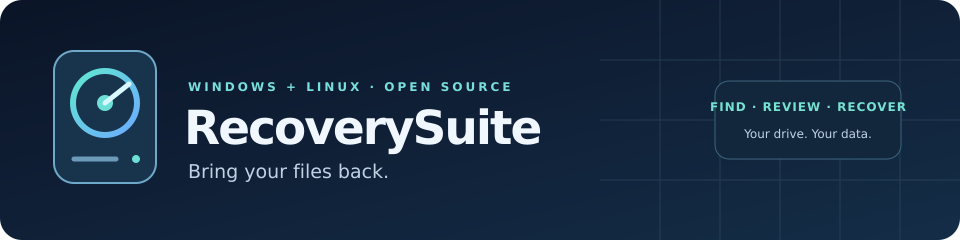

<div align="center">



<br>

[](#windows)
[](#linux)
[](LICENSE)
[](#supported-recovery)

**Recover lost files from deleted partitions, accidental deletions, and interrupted writes.**

Documents, videos, archives, photos, code, and other files — on Windows and Linux.

### [⬇ Download for Windows & Linux](https://github.com/morbok/RecoverySuite/actions/runs/42355941877/artifacts/13567617573)

[Download & install](#download--install) · [Quick start](#quick-start) · [Supported recovery](#supported-recovery) · [Help](#troubleshooting) · [Documentation](docs/README.md)

</div>

## Features

- **Recover general files** from supported FAT, exFAT, NTFS and ext4 records.
- **Find lost partitions** when recognizable filesystem metadata survives.
- **Review before saving** with search, filters, file selection and bounded previews.
- **Save scan progress** and continue later with the same source.
- **Rescue readable sectors** to an image, with reported gaps and checkpoint resume.
- **Keep source access read-only** and recover selected files to another physical drive.
- **Run locally** — no API keys, subscription, or cloud account needed.

> **Development prototype:** unsigned and tested on disposable CI fixtures. Physical failing-drive qualification is still pending. See [supported recovery](#supported-recovery) for limits.

## Download & install

### 1. Download the app

**[Download RecoverySuite-prototype.zip](https://github.com/morbok/RecoverySuite/actions/runs/42355941877/artifacts/13567617573)** — contains both Windows and Linux packages.

- Sign in to GitHub if the download asks you to.
- Extract the downloaded ZIP. Inside it, you will find:

```text
RecoverySuite-prototype/
├── Windows/         Windows portable ZIP
├── Linux/           Ubuntu DEB + Linux TAR.GZ
├── START_HERE.md    Installation notes
├── SHA256SUMS       Package checksums
└── manifest.json    Source commit and build information
```

The outer folder name depends on where you extract it. **Choose the package for your OS below; you don't need to compile anything.** GitHub's **Code → Download ZIP** downloads source code, not the ready-to-run application.

<details>
<summary>Download unavailable? Find a newer build</summary>

GitHub CI downloads expire. Open [Build and test](https://github.com/morbok/RecoverySuite/actions/workflows/build.yml), select a successful run, scroll down to **Artifacts**, then download **RecoverySuite-prototype**. A combined package appears only after all required build checks pass.

The download linked above is from [validated commit fec923c](https://github.com/morbok/RecoverySuite/actions/runs/42355941877). There is no signed stable release yet.

</details>

### 2. Install and open

<a id="windows"></a>
#### Windows

1. Open the extracted **Windows** folder.
2. Extract the ZIP inside it to a new folder.
3. Open **bin → RecoverySuite_GUI.exe**. Keep the bundled DLLs and plugins in place.

If Windows reports a missing Visual C++ runtime, install Microsoft's [Visual C++ 2015–2022 x64 Redistributable](https://aka.ms/vs/17/release/vc_redist.x64.exe).

<a id="linux"></a>
#### Linux

**Ubuntu 24.04 — DEB package**

Open a terminal inside the extracted prototype folder:

```bash
sudo apt install ./Linux/RecoverySuite-*.deb
RecoverySuite_GUI
```

**Linux TAR.GZ — without installing the application package**

From the same extracted prototype folder:

```bash
mkdir -p recoverysuite
tar -xzf Linux/RecoverySuite-*.tar.gz -C recoverysuite
./recoverysuite/usr/bin/RecoverySuite_GUI
```

The archive requires the Ubuntu 24.04 build distribution's Qt6 Core/Gui/Widgets/DBus and libudev runtime libraries. Desktop authorization uses UDisks2/polkit. Other Linux distributions are not yet qualified.

<details>
<summary>Verify the download</summary>

The outer download contains `SHA256SUMS` and `manifest.json`. Compare your selected package's SHA-256 with its entry before use.

Linux:

```bash
sha256sum -c SHA256SUMS
```

Windows PowerShell:

```powershell
Get-FileHash .\Windows\RecoverySuite-*.zip -Algorithm SHA256
```

Compare the Windows hash with the matching `Windows/` entry in `SHA256SUMS`. These checks verify package integrity, not publisher signing.

</details>

## Quick start

### 1. Choose the affected drive

Connect the disk and select it in **Drives**, matching its capacity and device path. Choose **Use selected drive**.

**Use another physical disk for recovered files.** Linux source volumes must be unmounted; Windows source disks must already be offline. The active system disk is not a supported source.

If access is denied, choose **Authorize read-only access…** on Linux or **Open administrator window…** on Windows.

### 2. Search for lost data

Click **Search for lost data**. Leave deep signature search enabled for additional JPEG/PDF/ZIP candidates, or disable it for filesystem records only.

Have a disk image already? Choose **Open an existing disk image instead…**. Images are optional sector-by-sector source files; recovery is not limited to pictures.

### 3. Review what was found

Filter by filename, folder or extension. Highlight a candidate and choose **Inspect highlighted file…** for a bounded thumbnail or text/hex preview. Check the files you want to recover.

### 4. Recover your selected files

Choose an existing destination folder on another physical disk, then click **Recover selected files**. Existing output files are preserved; recovered bytes are read back and verified.

A successful copy verifies the export. It does not prove deleted contents were never overwritten, and a preview does not prove the entire file is intact.

### Pause or continue later

Choose **Cancel** to pause a scan, then **File → Save scan results…** to save a `.rscan` catalog on another disk. Reopen it using **File → Open saved scan…**, then **File → Continue interrupted scan**. Keep the original source available at the same path. A catalog stores results and progress, not the recovered file contents.

### If the disk has read errors

Use **File → Rescue drive to image (logs unreadable sectors)…** to copy readable sectors to another disk. Keep the image and its `.rescue.json` report together. **File → Continue interrupted rescue…** resumes verified checkpoints.

Unreadable sectors become explicitly reported zero-filled gaps. Rescue cannot recreate missing data or guarantee a timeout when the operating system stalls. See the [rescue guide](docs/USER_GUIDE.md#rescue-a-disk-with-read-errors) before use.

## Supported recovery

Filesystem recovery works with general file contents, regardless of extension. Deep signature search has a narrower list of supported formats.

| Source / method | Implemented behavior | Main limits |
| --- | --- | --- |
| FAT12/16/32 | Supported existing/deleted file candidates and folder reconstruction | Deleted chains are uncertain; bounded cluster analysis, automatic streaming up to 2 GiB |
| exFAT 1.0 | Single-FAT files/folders, retained deleted entries, checked backup boot fallback | No TexFAT; surviving valid geometry/allocation metadata required |
| NTFS | Bounded supported MFT/file reconstruction, including supported deleted candidates | No encrypted/compressed streams or unsupported attribute layouts |
| ext4 | Retained allocated files, extent trees, sparse ranges and checked indexed directories | No deleted-inode recovery or journal replay |
| Lost partitions | Discover recognizable surviving filesystem metadata without partition entries | Cannot reconstruct every destroyed boot region/superblock |
| Signature search | JPEG, PDF and ZIP candidates | Up to 16 MiB per candidate; arbitrary fragmented carving is unsupported |

Current scan bounds include **10,000 candidates**, **128 volumes**, and **up to 2 GiB per supported streamed file**, with smaller parser-specific limits. Scan details explain skipped or partial records.

Overwritten, unwritten, or SSD TRIM-discarded bytes cannot be recreated. Unsupported filesystems, physical failures, encrypted/compressed content and heavily damaged metadata can prevent recovery. See [product scope](docs/PRODUCT_SCOPE.md) for exact boundaries.

## Troubleshooting

| Message or situation | Next step |
| --- | --- |
| Source mounted / busy / online | Prepare the disk outside RecoverySuite, then refresh. Do not use the active OS disk. |
| Access denied | Use the authorization action. On Linux, check UDisks2 and the desktop authentication agent. |
| Destination rejected / file already exists | Choose another physical disk and a new output name. Existing data is preserved. |
| Saved scan rejected | Reconnect the same source at the same path, or start a new scan. |
| No candidates / partial results | Read scan details. Metadata may be unsupported, overwritten or unreadable. A rescue image can preserve readable sectors. |

The [complete user guide](docs/USER_GUIDE.md) covers scanning, previews, saved catalogs, rescue, and error handling.

## Build and validation

For source builds, see [contributing](CONTRIBUTING.md). CMake 3.20+, C++20 and Qt6 are required.

CI runs Windows Release, Linux Debug/Release, 31 CTest executables per configuration, bounded ASan/UBSan parser fuzzing, package checks, and owned disposable loop/VHD/device-error fixtures. The combined prototype is produced only after its required build jobs pass. A separate **Credential safety** workflow scans available Git history for suspected secrets.

Synthetic CI success does not establish physical-hardware qualification. See [release acceptance](docs/RELEASE_ACCEPTANCE.md) and [release QA](docs/RELEASE_QA.md).

## Repository guide

| Location | Purpose |
| --- | --- |
| `src/` | Application, GUI/CLI, disk access and recovery implementation |
| `include/` | Public partition interfaces |
| `tests/` | Automated tests and parser fuzz harness |
| `scripts/` | CI packaging, disposable-device fixtures and credential checks |
| `cmake/`, `packaging/` | Build packaging and desktop assets |
| `docs/` | [Documentation index](docs/README.md), user guide, scope and development records |
| `docs/archive/` | Historical milestone notes; not current instructions |
| `.github/`, `.githooks/` | CI workflows and opt-in contributor commit protection |

## Privacy, security and license

**No API keys, cloud accounts or paid services are required for recovery.** Keep credentials, private configuration, disk images, recovered files, scan catalogs and rescue reports outside Git. Never attach real disk data or credentials to public issues. See [security guidance](SECURITY.md).

RecoverySuite's own code is [MIT licensed](LICENSE). Bundled dependencies retain their respective licenses and [notices](docs/THIRD_PARTY_NOTICES.md).
